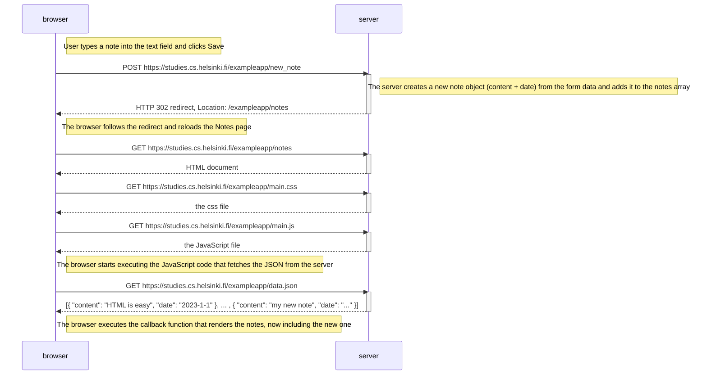
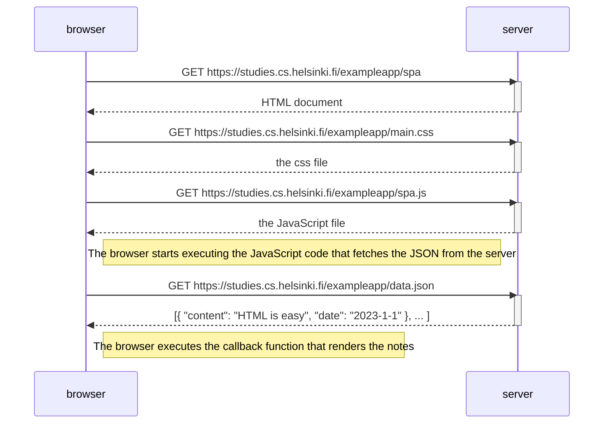
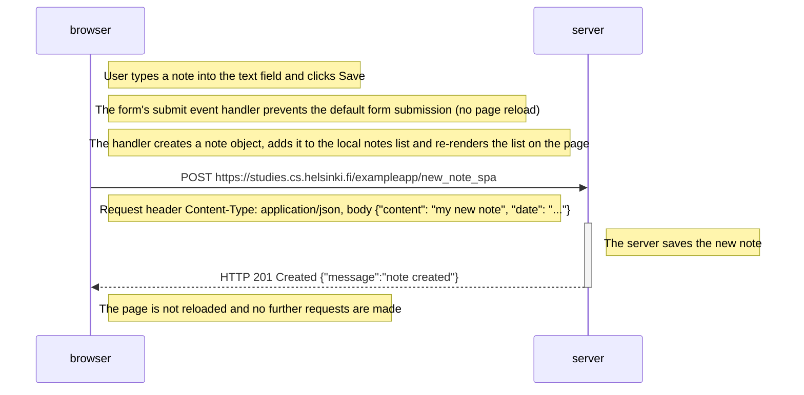

# Part 0 – Exercises 0.4–0.6

Exercises 0.1–0.3 are reading only and are not submitted to GitHub.

## 0.4: New note diagram

## 0.5: Single page app diagram

## 0.6: New note in Single page app diagram

